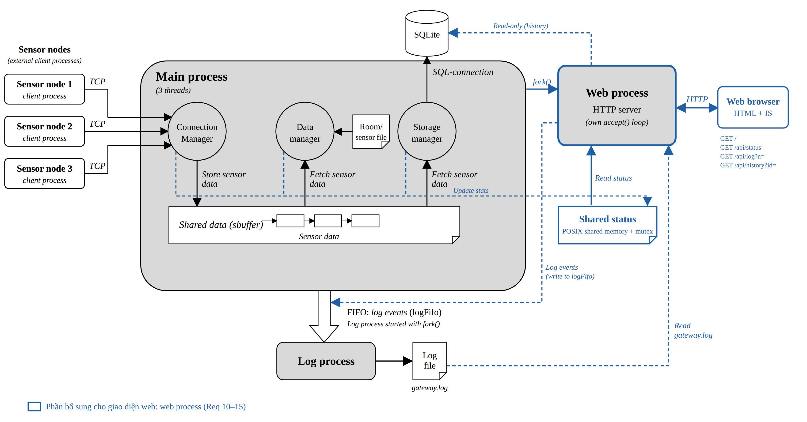

# devlinux_gateway_sensor
Mid-term project of Devlinux course

# Prerequisites

- OS: Linux OS
- GNU Make: `make`

# Architecture design


# Description

A gateway program to handle incoming message from client sensor via TCP/IP with multiple message protocols. Record data in SQLLite3 database and monitor sensor data to HTTP website

Each client sensor with its own protocol connects to provided listening port

Sensor protocol supported: 
- TBP(Temperature binary protocol)
- HLP(Humidity Line Protocol)
- SGP(Smoke-Gas protocol) 
- EVP(Event TLV Protocol)

User provide gateway's base port for TBP port via input positional argument
HLP port will offset by 1
EVP port will offset by 2
SGP port will offset by 3

For example:
````
The base port is 1234
HLP's port is 1235
EVP's port is 1236
SGP's port is 1237
````

# Project structure
```tree
├── LICENSE
├── Makefile
├── README.md
├── assets
│   └── architecture_design.jpg
├── include
│   ├── common.h
│   ├── connection_manager.h
│   ├── data_manager.h
│   ├── endecode_helper.h
│   ├── logger.h
│   ├── protocol_adapter.h
│   ├── sensor_config.h
│   ├── sensor_types.h
│   ├── server.h
│   └── storage_manager.h
├── src
│   ├── client.c
│   ├── connection_manager.c
│   ├── endecode_helper.c
│   ├── gateway.c
│   └── logger.c
```
# Build the project
Default:
```make
make
```
Output:
```bash
mkdir -p ./obj
gcc -Wall -Wextra -std=gnu99 -Iinclude -g -O0 -pthread -c src/gateway.c -o obj/gateway.o
gcc -Wall -Wextra -std=gnu99 -Iinclude -g -O0 -pthread -c src/connection_manager.c -o obj/connection_manager.o
gcc -Wall -Wextra -std=gnu99 -Iinclude -g -O0 -pthread -c src/endecode_helper.c -o obj/endecode_helper.o
gcc -Wall -Wextra -std=gnu99 -Iinclude -g -O0 -pthread -c src/logger.c -o obj/logger.o
mkdir -p ./lib
ar rcs lib/libconnection_manager.a obj/connection_manager.o obj/endecode_helper.o obj/logger.o
ar rcs lib/libendecode_helper.a obj/connection_manager.o obj/endecode_helper.o obj/logger.o
ar rcs lib/liblogger.a obj/connection_manager.o obj/endecode_helper.o obj/logger.o
mkdir -p ./bin
gcc -Wall -Wextra -std=gnu99 -Iinclude -g -O0 -pthread obj/gateway.o -L./lib  -lconnection_manager  -lendecode_helper  -llogger -o ./bin/gateway
gcc -Wall -Wextra -std=gnu99 -Iinclude -g -O0 -pthread -c src/client.c -o obj/client.o
gcc -Wall -Wextra -std=gnu99 -Iinclude -g -O0 -pthread obj/client.o -L./lib  -lconnection_manager  -lendecode_helper  -llogger -o ./bin/client
```

Build with `-DDEBUG` option:
__*Note*__: Must call `make clean first`
```make
make EXTRA_CFLAGS="-DDEBUG"
```
Output:
```plaintext
mkdir -p ./obj
gcc -Wall -Wextra -std=gnu99 -Iinclude -g -O0 -pthread -DDEBUG -c src/gateway.c -o obj/gateway.o
gcc -Wall -Wextra -std=gnu99 -Iinclude -g -O0 -pthread -DDEBUG -c src/connection_manager.c -o obj/connection_manager.o
gcc -Wall -Wextra -std=gnu99 -Iinclude -g -O0 -pthread -DDEBUG -c src/endecode_helper.c -o obj/endecode_helper.o
gcc -Wall -Wextra -std=gnu99 -Iinclude -g -O0 -pthread -DDEBUG -c src/logger.c -o obj/logger.o
mkdir -p ./lib
ar rcs lib/libconnection_manager.a obj/connection_manager.o obj/endecode_helper.o obj/logger.o
ar rcs lib/libendecode_helper.a obj/connection_manager.o obj/endecode_helper.o obj/logger.o
ar rcs lib/liblogger.a obj/connection_manager.o obj/endecode_helper.o obj/logger.o
mkdir -p ./bin
gcc -Wall -Wextra -std=gnu99 -Iinclude -g -O0 -pthread obj/gateway.o -L./lib  -lconnection_manager  -lendecode_helper  -llogger -o ./bin/gateway
gcc -Wall -Wextra -std=gnu99 -Iinclude -g -O0 -pthread -DDEBUG -c src/client.c -o obj/client.o
gcc -Wall -Wextra -std=gnu99 -Iinclude -g -O0 -pthread obj/client.o -L./lib  -lconnection_manager  -lendecode_helper  -llogger -o ./bin/client

```
# Load the server program
For example to listen on port 1234:
```bash
./bin/gateway 1234
```
# Load the client program
```bash
./bin/client temperature 10 127.0.0.1 1234 1000
./bin/client humidity 21 127.0.0.1 1235 1000
./bin/client motion 30 127.0.0.1 1236 1000
./bin/client door 40 127.0.0.1 1236 1000
./bin/client smoke_gas 50 127.0.0.1 1237 1000
```
# Output
Gateway log without sensor client connection:
```
make gw 
./bin/gateway 1234
Gateway started...
thread_connmgr created
Listening on port:1234
thread_datamgr created
thread_storagemgr created
Listening on port:1235
Listening on port:1236
Listening on port:1237
Waiting new connection
Child received: MAIN Gateway started...
Child received: CONN Created
^C
Signal handler:SIGINT Exiting cleanly
Child received: 

Signal handler:SIGINT Exiting cleanly
Child received: CONN terminated
Gateway is shutting down
Child received: DATA terminated
Child received: STOR terminated
Child: EOF, close fd now

```
`gateway.log`:
```
1 2026-10-13 13:24:22 MAIN Gateway started...
2 2026-10-13 13:24:22 CONN Created
3 2026-10-13 13:24:22 DATA Created
4 2026-10-13 13:24:22 STOR Created
5 2026-10-13 13:24:24 CONN terminated
6 2026-10-13 13:24:25 DATA terminated
7 2026-10-13 13:24:25 STOR terminated
8 2026-10-13 13:24:25 MAIN Gateway is shutting down
```
Gateway log with sensors connected:
```
./bin/gateway 1234
Gateway started...
thread_connmgr created
thread_storagemgr created
Listening on port:1234
thread_datamgr created
Listening on port:1235
Listening on port:1236
Listening on port:1237
Waiting new connection
Child received: MAIN Gateway started...
Child received: STOR Created
Client connected from IP: 127.0.0.1, Port: 1234
New connection arrived
n_conns:0
Sensor ID:10
Sensor type:SENSOR_TEMPERATURE
Sensor value:-11.88
Timestamp:1791873050
Child received: A sensor node with 10 has opened a new connection
Client connected from IP: 127.0.0.1, Port: 1235
New connection arrived
n_conns:1
Sensor ID:21
Sensor type:SENSOR_HUMIDITY
Sensor value:95.90
Timestamp:1791873050
Child received: A sensor node with 21 has opened a new connection
Client connected from IP: 127.0.0.1, Port: 1236
New connection arrived
n_conns:2
Sensor ID:30
Sensor type:SENSOR_MOTION
Sensor value:1.00
Timestamp:1791873050
Child received: A sensor node with 30 has opened a new connection
Client connected from IP: 127.0.0.1, Port: 1236
New connection arrived
n_conns:3
Sensor ID:40
Sensor type:SENSOR_DOOR
Sensor value:1.00
Timestamp:1791873050
Child received: A sensor node with 40 has opened a new connection
Client connected from IP: 127.0.0.1, Port: 1237
New connection arrived
n_conns:4
Sensor ID:50
Sensor type:SENSOR_SMOKE_GAS
Sensor value:100.00
Timestamp:1791873050
Child received: A sensor node with 50 has opened a new connection
^C
Signal handler:SIGINT Exiting cleanly

Signal handler:SIGINT Exiting cleanly
Child received: 
Release resource client connection
Release resource listen port
Child received: CONN terminated
Child received: STOR terminated
Gateway is shutting down
Child received: DATA terminated
Child received: MAIN Gateway is shutting down
Child: EOF, close fd now
```
`gateway.log`:
```
1 2026-10-13 13:30:42 MAIN Gateway started...
2 2026-10-13 13:30:42 STOR Created
3 2026-10-13 13:30:42 CONN Created
4 2026-10-13 13:30:42 DATA Created
5 2026-10-13 13:30:50 A sensor node with 10 has opened a new connection
6 2026-10-13 13:30:50 A sensor node with 21 has opened a new connection
7 2026-10-13 13:30:50 A sensor node with 30 has opened a new connection
8 2026-10-13 13:30:50 A sensor node with 40 has opened a new connection
9 2026-10-13 13:30:50 A sensor node with 50 has opened a new connection
10 2026-10-13 13:30:55 CONN terminated
11 2026-10-13 13:30:55 STOR terminated
12 2026-10-13 13:30:56 DATA terminated
13 2026-10-13 13:30:56 MAIN Gateway is shutting down
```
